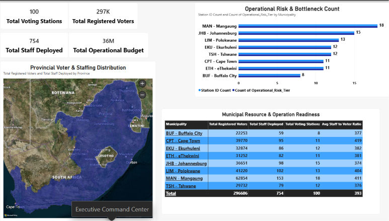
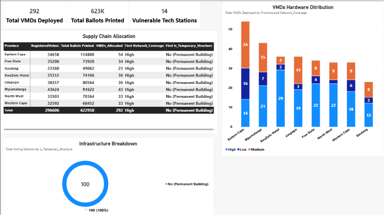
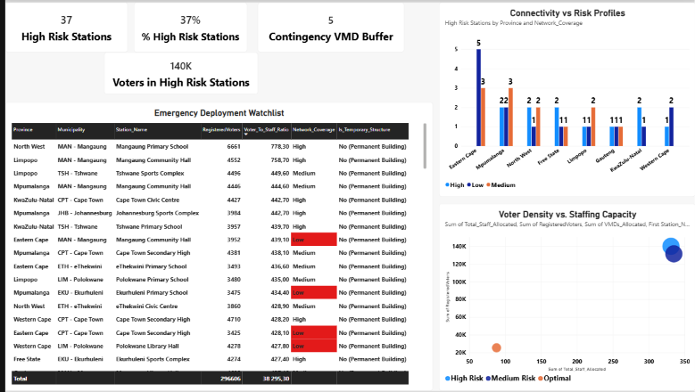

# South African Local Government Elections: Operational Readiness & Resource Capacity Model

An end-to-end data engineering and interactive Power BI analytics suite designed to evaluate the operational logistics, workforce allocation, hardware deployment, and risk bottlenecks for the Electoral Commission of South Africa (IEC).

---

## 📊 Executive Dashboards Overview

### Page 1: Executive Command Center (ECC)

*Provides macro-level visibility into national voter roll distribution, total active voting stations, staffing deployment counts, and provincial density metrics.*

---

### Page 2: Hardware, Supply Chain & Field Infrastructure (H&L)

*Tracks logistical supply chain assets, including Voter Management Device (VMD) allocation, 5% buffered ballot paper printing, and permanent vs. temporary (tent/mobile) facility distribution.*

---

### Page 3: Operational Risk & Contingency Heatmap (R&CH)

*Identifies high-vulnerability voting districts facing queue congestion (staff-to-voter ratio > 420) or low network connectivity, enabling targeted field contingency planning.*

---

## 🛠️ Tech Stack & Architecture

- **Data Simulation & Pipeline:** Python (`Pandas`, `NumPy`)
- **Relational Data Warehouse:** SQLite 3
- **Business Intelligence & DAX:** Power BI Desktop
- **Version Control:** Git & GitHub

---

## ⚙️ Data Pipeline & Resource Allocation Logic

1. **Staffing Allocation Formula:** $1 \text{ PO} + 1 \text{ DPO} + \max(3, \lfloor \frac{\text{Voters}}{500} \rfloor) \text{ Electoral Officers}$
2. **Hardware Deployment:** $1 \text{ Base VMD} + \lfloor \frac{\text{Voters}}{1200} \rfloor$
3. **Ballot Paper Buffer:** $\text{Registered Voters} \times 1.05$ (5% safety stock)
4. **Risk Classification:** Stations tagged as **High Risk** if staff ratio $> 420$ or network coverage is **Low**.

---

---

## 📌 Conclusion & Business Impact

This operational capacity model demonstrates how data-driven workforce and logistics modeling can optimize large-scale public sector execution:

- **Proactive Bottleneck Mitigation:** By identifying high-strain voting districts (staff-to-voter ratio $> 420$) before Election Day, resource planners can reallocate floating field officers and deploy backup VMD hardware to high-density municipal zones.
- **Data-Driven Supply Chain Efficiency:** Implementing a standardized $5\%$ ballot paper buffer prevents both stockouts in dense wards and excessive over-printing spend in smaller districts.
- **Technology & Infrastructure Risk Management:** Tagging sites operating under low network connectivity allows field ops teams to ensure offline VMD local databases are fully synced prior to doors opening.

---

## 🔮 Future Roadmap 

The next phase of this project turns from **Pre-Vote Operational Readiness** to **Post-Vote Performance & Financial Variance Analysis**:

1. **Turnout Impact on Unit Cost:** Evaluating how actual voter turnout impacts the *Cost Per Realized Vote* across municipalities.
2. **Budget vs. Actual Variance Analysis:** Reconciling actual operational spend against the baseline budget allocation.
3. **Queue & Processing Delay Diagnostics:** Correlating VMD sync logs and queue wait times against predicted staffing models.

---

